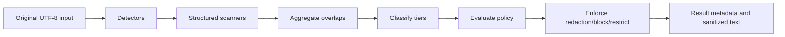

# Architecture

The engine pipeline is:

Detectors emit metadata-only findings with byte offsets into the original
input. Aggregation resolves duplicate and overlapping spans deterministically.
Classification raises detector tiers to configured mappings unless an explicit
override is present. Policy produces the overall action; only REDACT findings
reach the redactor. BLOCK returns no sanitized text.

The engine is immutable after `New` and safe for concurrent use. The core uses
no network or file I/O. Structured JSON failures fall back to ordinary detector
scanning and set `Result.StructuredFallback`.

## Package boundaries

- The root package owns public orchestration, configuration, and result types.
- `detector` owns built-in/custom detection, detector registration, and the
  metadata-only `Finding` domain type.
- `structured` scans supported structured formats and preserves original byte
  offsets; it does not evaluate policy.
- `internal/findings` is the private aggregation and overlap-resolution step.
- `classifier` assigns sensitivity tiers without changing spans or input.
- `policy` loads and evaluates deterministic rules without redacting content.
- `redactor` validates spans and transforms text only after policy evaluation.

Dependencies point inward toward domain operations: the root coordinates the
packages, while lower-level packages do not import the root package. No package
performs network access, file access, or process execution.
